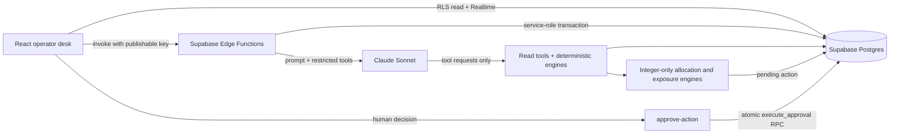
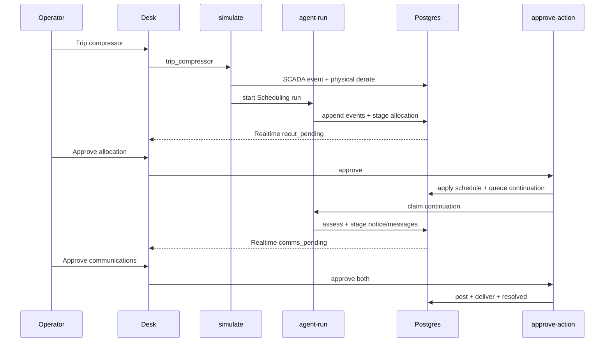

# Nomination Desk Architecture

Nomination Desk is a synthetic natural-gas scheduling reference implementation. It separates
probabilistic reasoning from deterministic calculation and authoritative writes.

## Trust boundaries

### Browser

- Uses only the project URL and browser-safe publishable key.
- Has `SELECT` access under RLS and zero table write grants.
- Subscribes to Realtime updates for scenario, run, event, action, notice, nomination, and segment
  state.
- Invokes Edge Functions for simulation and human decisions.

### Edge Functions

- `simulate` injects physical telemetry, loads deterministic scenarios, and restores baselines.
- `agent-run` owns the Supervisor/Scheduling/Exception/Communications workflow.
- `approve-action` calls one transactional RPC to execute or reject a pending action.
- Service-role and Anthropic credentials remain in hosted function secrets.
- Custom project-caller validation is a reference-scope boundary, not production authentication.

### Tool and engine layer

- Historian, EBB, contract, topology, and operations-SOR tools are bounded reads.
- Allocation, capacity, imbalance, and exposure engines use exact integer Dth, basis points, and
  cents.
- Model-facing staging tools can create only `pending_actions`; they cannot apply schedules,
  post notices, or deliver messages.
- Staging guards compare model payloads against the active scenario's deterministic answer key.

### Skills and playbooks

- Runtime skills are versioned rows in the Supabase `skills` table and are loaded at the start of
  each specialist run.
- `Scheduling` loads Derate Response and Capacity Shortfall; `Exception` loads Derate Response;
  `Communications` loads Shipper Communication.
- The Markdown files under `/skills` are expanded operator-readable references. Migration
  `0005_seed_skills.sql` contains the runtime-optimized skill bodies with the corresponding IDs and
  versions.
- Every event records the skill ID and version used, preserving the operating-procedure context
  behind a decision.

### Postgres

- `agent_events` is append-only.
- `execute_approval` commits the decision event, domain mutation, phase transition, and continuation
  outbox together.
- Scenario loading, reset, and hero restoration are transactional and blocked during active runs.
- Every remote DDL change has a matching migration under `supabase/migrations/`.

## Workflow sequence

## Operator and technical audit views

The desk presents one append-only event stream in two modes. The underlying rows, dispute export,
and raw tool payloads are unchanged.

- **Operator** hides first-person planning prose, groups adjacent tool call/result pairs into one
  evidence step, renders summaries without exposing Markdown artifacts, converts ISO timestamps to
  Central Time, strips internal run/trigger identifiers from displayed text, and surfaces key
  capacity, allocation, compliance, and approval facts above raw JSON.
- **Technical** preserves every event, including planning narration and full provider/tool detail,
  for engineering review.

Persisted summaries are normalized to plain text at write time. Specialist prompts forbid Markdown,
planning narration, and internal identifiers in new model-authored summaries.

## Realtime recovery

The audit unit is `workflow_id`, not an individual run. The client:

1. subscribes to event inserts
2. fetches the complete backlog across correlated runs
3. merges by `(run_id, seq)`
4. sorts by run start and per-run sequence

Subscribing before the fetch and deduplicating afterward prevents gaps and doubles during reloads.

## Deployment modes

- **Live desk:** requires browser-safe Supabase values and permits gated synthetic operations.
- **Replay-only desk:** built with `npm run build:replay`; starts in the captured verified workflow,
  strips Supabase values at compile time, and cannot perform remote writes or model calls.

Production would add SSO, role-based approval limits, server-side rate limits, immutable audit
export, MCP-based source-system adapters, and shadow-mode evaluation before any autonomy
expansion. The tool layer already uses MCP-shaped contracts — structured definitions, typed
results, no side channels — so production integration replaces the simulated Postgres modules
behind the same agent-facing interface.
